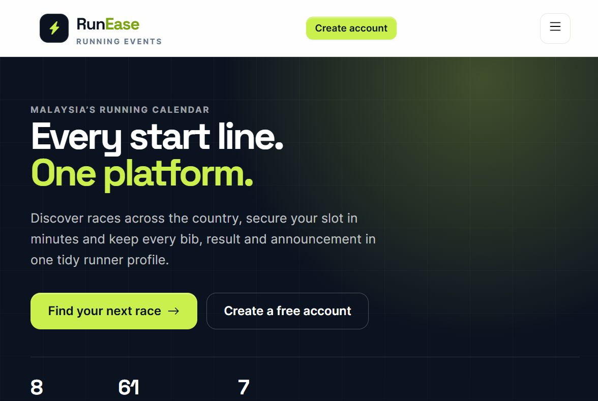

# RunEase — Running Event Management System

A complete Java EE web application for the full lifecycle of running events: discovery,
registration, payment, race-day operations, reporting and platform governance.

Built for **CSC584 Enterprise Programming** (Universiti Teknologi MARA) using the
Model-View-Controller pattern, Jakarta Servlets, JSP/JSTL, JDBC and a normalised
relational database.



---

## 1. Overview

RunEase replaces the usual collection of form builders, spreadsheets, bank-transfer
screenshots and messaging groups with one role-aware platform.

| Role | What they can do |
| --- | --- |
| **Visitor** | Browse and search approved events, filter by type/state/date, compare race categories and prices. |
| **Participant** | Register, pay immediately or reserve an entry, receive a registration code and bib number, view or cancel entries, manage profile. |
| **Organiser** | Create event drafts, manage categories and quotas, submit for approval, check runners in, record results with automatic rankings, publish announcements, export reports. |
| **Administrator** | Verify organisers, approve or reject events with reasons, manage user accounts asynchronously, review platform reports and the audit trail. |

**Demo data:** 20 users, 3 organisers, 10 events, 20 race categories, 59 registrations,
59 payments, 13 results, 5 announcements and audit history.

---

## 2. Quick start

### Prerequisites

- **JDK 21** (`java -version`)
- **Maven 3.9+** — optional, because the Maven wrapper (`mvnw.cmd`) downloads it automatically
- No database server required (embedded H2)

### Run on Windows

```powershell
.\run.ps1
```

or

```bat
run.cmd
```

Then open <http://localhost:8080/>.

To use another port:

```powershell
.\run.ps1 -Port 9090
```

### Run with Maven directly

```powershell
.\mvnw.cmd -B compile exec:java
# or, with Maven installed:
mvn -B compile exec:java
```

The first start creates `./data/runease.mv.db`, applies `schema.sql`, loads the
demonstration data, and prints the demo accounts.

### Build the deployable WAR

```powershell
.\run.ps1 -Package
# target/runease.war  ->  copy into Tomcat 10.1+ webapps/
```

### Reset the demonstration data

Stop the server, delete the `data` folder, and start again.

### Publish it on the internet

To let friends open RunEase from their own laptops without your computer running,
deploy it to a web host. The included `Dockerfile`, `render.yaml` and
`docs/DEPLOYMENT.md` cover free options such as Render and Railway, plus Azure
App Service and a VPS.

```powershell
# optional: test the exact container entrypoint locally (Docker Desktop)
docker build -t runease .
docker run -p 8080:8080 runease
```

Quick version with Render:

1. Publish the project to GitHub (GitHub Desktop is easiest).
2. On <https://render.com>: **New → Blueprint**, pick the repository.
3. Wait for the build, then share the `https://runease-xxxx.onrender.com` URL.

The free plan sleeps after 15 minutes of inactivity and resets demonstration data
when it restarts. Full instructions: [`docs/DEPLOYMENT.md`](docs/DEPLOYMENT.md).

---

## 3. Demonstration accounts

All seeded accounts use the password **`Password123!`**.

| Role | Email | Notes |
| --- | --- | --- |
| Administrator | `admin@runease.my` | Verification queue, event approval, users, audit |
| Organiser | `ahmad@paceevents.my` | Pace Events; owns events 1, 2, 4, 7 and 9 |
| Participant | `alia@student.uitm.edu.my` | Runner with several seeded entries |
| Participant | `kavin@runease.my` | Additional runner for registration tests |

New participants and organisers can also be created from **Create account**.

---

## 4. Technology stack

| Layer | Technology |
| --- | --- |
| Language | Java 21 |
| Web API | Jakarta EE 10 — Servlet 6.0, JSP 3.1, JSTL 3.0 |
| Persistence | JDBC with explicit DAO classes; H2 (MySQL compatibility mode) or MySQL 8 |
| Build / packaging | Maven, WAR, embedded Tomcat 10.1.62 runner |
| View | JSP, JSTL, HTML5, Bootstrap 5.3, custom CSS design system |
| Client behaviour | Vanilla ES modules: fetch-based CRUD, modals, toasts, confirmation dialogs |
| Security | BCrypt, CSRF synchroniser token, RBAC filter, security headers, audit log |
| Deployment | WAR on Tomcat 10.1, or Docker image for Render/Railway/Azure |
| Documentation | python-docx proposal, matplotlib diagrams, real browser screenshots |

---

## 5. Architecture

```
Browser
  │  HTML forms + fetch (JSON)
  ▼
Filters          Encoding → SecurityHeaders → Flash → CSRF → Auth
  ▼
Servlets         BaseServlet (routing, layout, error mapping)
  ▼
Services         Business rules, transactions, validation orchestration
  ▼
DAOs             JDBC prepared statements, row mapping, pagination
  ▼
Database         H2 / MySQL — 9 tables in 3NF with FK, unique and CHECK constraints
```

```
src/main/java/my/uitm/runease
├── config        Db connection pool helpers, transaction/read wrappers, schema bootstrap
├── model         JavaBeans and enums (User, Event, EventCategory, Registration, Payment, Result, …)
├── dao           Data access objects (UserDao, EventDao, RegistrationDao, ReportDao, AuditDao, …)
├── service       AuthService, EventService, RegistrationService, ResultService, ReportService, …
└── web           Filters, BaseServlet, Web/Validation utilities, AppException, 15 servlets
```

### Request lifecycle

1. A filter chain applies UTF-8 encoding, security headers, flash-message handling,
   CSRF verification for state-changing methods, and session/role checks.
2. The servlet validates input, calls a service method, and selects a JSP view through
   one of three layout shells (`public`, `auth`, `app`).
3. Services run business rules inside database transactions and write audit entries.
4. Errors are mapped to field messages, flash notices, or branded 403/404/500 pages.

### Security controls

- BCrypt password hashing; plaintext is never stored.
- Session ID rotation on login; 30-minute timeout; `HttpOnly`, `SameSite=Lax` cookie.
- Role-based access control in `AuthFilter` plus per-record ownership checks.
- CSRF token required on every POST/PUT/PATCH/DELETE, exposed through a meta tag and hidden field.
- Content-Security-Policy, `X-Frame-Options`, `X-Content-Type-Options`, `Referrer-Policy`,
  `Permissions-Policy`, and `Cache-Control: no-store` on sensitive responses.
- Quota checks use `SELECT … FOR UPDATE` inside a transaction to prevent overselling.
- Audit entries are written in the same transaction as the business change.

---

## 6. Main routes

| Area | Routes |
| --- | --- |
| Public | `/`, `/events`, `/events/{id}`, `/login`, `/register`, `/logout` |
| Participant | `/dashboard`, `/checkout?category=…`, `/registrations`, `/registrations/{id}`, `/profile` |
| Organiser | `/organizer`, `/organizer/events`, `/organizer/events/new`, `/organizer/events/{id}`, `/organizer/participants`, `/organizer/results`, `/organizer/announcements`, `/organizer/reports` |
| Administrator | `/admin`, `/admin/events`, `/admin/events/{id}`, `/admin/organizers`, `/admin/users`, `/admin/reports`, `/admin/audit` |
| JSON API | `/api/admin/users` — `GET`, `POST`, `PUT`, `PATCH`, `DELETE` with `X-CSRF-Token` |

Every listing supports search, filters, sorting and pagination through a reusable
`Page<T>` object that preserves the query string.

---

## 7. Database

### Default: embedded H2

- URL: `jdbc:h2:file:./data/runease;MODE=MySQL;DATABASE_TO_LOWER=TRUE;DB_CLOSE_ON_EXIT=FALSE`
- Schema and seed are applied automatically on first run.

### MySQL 8

```sql
mysql -u root -p < database/schema_mysql.sql
mysql -u root -p runease < database/seed_mysql.sql
```

```powershell
$env:RUNEASE_DB_URL = "jdbc:mysql://localhost:3306/runease?useSSL=false&serverTimezone=Asia/Kuala_Lumpur"
$env:RUNEASE_DB_USER = "runease"
$env:RUNEASE_DB_PASSWORD = "your-password"
.\run.ps1
```

The schema and seed are only auto-loaded for the embedded H2 database, so import
the MySQL scripts first.

### Tables

| Table | Purpose |
| --- | --- |
| `users` | Accounts, roles and status |
| `organizers` | Organisation profile and verification state |
| `events` | Event details and `DRAFT → PENDING → APPROVED/REJECTED` workflow |
| `event_categories` | Distance, price, quota and start time |
| `registrations` | Participant entry, bib, emergency and status data |
| `payments` | One-to-one payment record per registration |
| `results` | Finish time, overall/category position and pace |
| `announcements` | Organiser updates for all or confirmed participants |
| `audit_logs` | Actor, action, entity, description, IP and timestamp |

`database/schema_mysql.sql` is generated from `src/main/resources/db/schema.sql` by
`database/export_mysql.py`. Seed data is generated by `database/generate_seed.py`.

---

## 8. Assessment criteria coverage

| Criterion | Implementation | Where to look |
| --- | --- | --- |
| Dual-layer validation | HTML5 constraints + `Validation` utility + database `CHECK` constraints | register, login, checkout, event form, announcements, results |
| RBAC and session security | `AuthFilter`, ownership checks, session rotation, CSRF, security headers | every `/admin`, `/organizer`, `/checkout` and `/registrations` route |
| Asynchronous create/read | JSON API + `fetch` table rendering | `/admin/users` |
| Update with pre-filled forms/modals | `data-field-*` attributes, shared modal, action swapping | admin users, organiser events, announcements, results |
| Safe delete with confirmation | Shared confirmation modal, soft deletes, dependency checks | events, users, announcements, registrations, results |
| Search, sort, filter, pagination | `Page<T>` and filter bars with preserved state | catalogue, registrations, organiser and admin listings |
| Reports and export | `ReportService` plus filtered CSV download | `/organizer/reports`, `/admin/reports` |
| Responsive modern UI | Custom design system, responsive shells, off-canvas navigation | all screens from 360 px upward |
| Consistent navigation | Public/auth/app shells, breadcrumbs, active menu state | all screens |
| Graceful error handling | `AppException` mapping, branded 403/404/500, flash messages and toasts | all controllers and filters |

### Verified end-to-end during development

Automated smoke test (28 checks: page availability, role isolation, guest redirect,
CSRF rejection and JSON API access):

```powershell
.\scripts\smoke-test.ps1                 # server must be running
.\scripts\smoke-test.ps1 -BaseUrl http://localhost:9090
```

Manual checks performed during development:

- All three roles sign in and reach their dashboards; unauthorised routes are blocked.
- Participant registers with immediate card payment (code `RE-2026-0060`, bib `BIB10049`).
- Participant reserves an entry, pays later by FPX (code `RE-2026-0061`, bib `BIB10050`), then cancels.
- New participant account created, signed in and completed a registration.
- Organiser creates an event, adds a category, submits it; administrator approves it.
- Organiser checks a runner in, records a finish time (`0:52:41`), then deletes the result.
- Organiser creates, updates and deletes an announcement.
- Administrator verifies, rejects and restores organiser accounts.
- Admin users API returns `422` with field errors for invalid payloads.
- Server log is free of unexpected exceptions after the fixes to registration codes and event slug updates.

---

## 9. Project structure

```
RunEase/
├── src/main/java/my/uitm/runease/     Application source (config, model, dao, service, web)
├── src/main/resources/db/             schema.sql and seed.sql (H2/MySQL compatible)
├── src/main/webapp/
│   ├── WEB-INF/views/                 JSP views by role, fragments, error pages
│   ├── WEB-INF/web.xml                Session, filter and error-page configuration
│   └── assets/                        CSS design system, JS modules, Bootstrap, icons, fonts
├── database/
│   ├── generate_seed.py               Demo data generator
│   ├── export_mysql.py                MySQL export script
│   ├── schema_mysql.sql               MySQL 8 schema
│   └── seed_mysql.sql                 MySQL 8 demo data
├── docs/proposal/
│   ├── RunEase_Proposal.docx          Full proposal (38 pages)
│   ├── RunEase_Proposal.pdf           PDF copy
│   ├── build_proposal.py              Rebuilds the proposal
│   ├── build_diagrams.py              Rebuilds the ERD and flowchart
│   ├── screenshots/                   14 captured UI screens
│   └── images/                        ERD and application flowchart
├── run.ps1 / run.cmd                  One-command local server
├── scripts/smoke-test.ps1             End-to-end smoke test (28 checks)
├── Dockerfile / render.yaml           Cloud deployment (Tomcat 10.1 image)
├── docs/DEPLOYMENT.md                 Deploy to Render, Railway, Azure or a VPS
├── mvnw / mvnw.cmd                    Maven wrapper
└── pom.xml                            WAR build and embedded runner
```

---

## 10. Proposal and diagrams

The written proposal follows the required structure:

1. **1.0 Project Overview** — introduction, purpose, scope, users, modules, stack, rubric alignment
2. **2.0 Problem Statement** — current practice, eight identified problems, solution mapping, feasibility
3. **3.0 Objective** — general objective, seven specific objectives, success criteria
4. **4.0 Proposed User Interface** — design direction, navigation, 14 annotated screens, interaction patterns
5. **5.0 Database Design** — design approach, table summary, data dictionary, ERD, cardinality, integrity notes
6. **6.0 Flow of Application** — swimlane flowchart, flow narrative, validation and security flow
7. **7.0 Conclusion** — outcomes and next steps
8. **Appendices** — demo accounts and setup, project structure, rubric traceability matrix

| File | Description |
| --- | --- |
| `docs/proposal/RunEase_Proposal.docx` | Submission document |
| `docs/proposal/RunEase_Proposal.pdf` | Rendered PDF |
| `docs/proposal/images/erd.png` | Entity relationship diagram |
| `docs/proposal/images/flowchart.png` | Application flow across four roles |
| `docs/proposal/screenshots/` | Real screenshots from the running application |

Rebuild the documents:

```powershell
python docs\proposal\build_diagrams.py
python docs\proposal\build_proposal.py
```

---

## 11. Known limitations

- Payment is simulated; no gateway settlement or bank refund is performed.
- No email or SMS delivery; announcements are shown inside the application.
- Chip-timing hardware and native mobile apps are out of scope.
- Automated tests are limited to documented end-to-end verification with seeded data.
- The embedded Tomcat runner is for demonstration; production deployment should use a
  managed servlet container and MySQL with backups.

---

## 12. Group members

| No. | Name | Student ID |
| --- | --- | --- |
| 1 | WAN MUHAMMAD FAKHRI BIN WAN ZULKIFLI | 2024948805 |
| 2 | MOHAMAD NAQIUDIN BIN SANI | 2024142043 |
| 3 | NUR IZZATI NABILAH BINTI ABAS | 2024768875 |
| 4 | NURFARAHIN BINTI MOHD NAFIS | 2024587539 |
| 5 | NURUL AINI BINTI ABDULLAH | 2024979227 |

CSC584 Enterprise Programming · Semester October 2026 – February 2027
